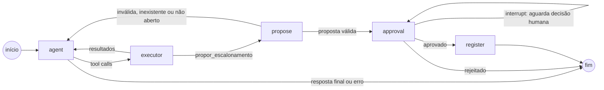

# Aurora — assistente de suporte

Assistente que consulta chamados de suporte e prepara escalonamentos para revisão humana. O modelo decide quais ferramentas usar; o backend valida, executa, aplica as regras de negócio e só registra um escalonamento depois de uma aprovação explícita.

Inclui também o bônus: um assistente de **viagens** que responde por RAG sobre uma base simulada, rodando no **mesmo grafo** com outra configuração (veja [Assistentes](#assistentes-bônus)).

**Stack:** TypeScript · Next.js 16 (App Router) · LangGraph · LangSmith · Zod · Vitest

## Início rápido

```bash
pnpm install
ollama pull qwen3.5:latest   # se for usar o modelo local
```

Com o [Claude Code](https://claude.com/claude-code) aberto na pasta do projeto, rode a skill do repositório:

```
/setup
```

Ela pergunta o provedor e o modelo, a configuração do LangSmith e os limites de execução, e gera um rascunho em `.env.setup` a partir do `.env.example`. As chaves não são pedidas no chat: você as preenche direto no arquivo. Depois:

```bash
mv .env.setup .env         # preencha as chaves que ficaram em branco
pnpm build && pnpm start   # http://localhost:3000
```

A skill nunca lê nem escreve o `.env`: só o rascunho. Sem o Claude Code, use o [caminho manual](#configuração).

## Sumário

- [Início rápido](#início-rápido)
- [Requisitos](#requisitos)
- [Instalação](#instalação)
- [Configuração](#configuração)
- [Execução](#execução)
- [Testes offline](#testes-offline)
- [Avaliação no LangSmith](#avaliação-no-langsmith)
- [Fluxo](#fluxo)
- [Assistentes (bônus)](#assistentes-bônus)
- [Arquitetura](#arquitetura)
- [Decisões](#decisões)
- [Observabilidade](#observabilidade)
- [Limitações](#limitações)

## Requisitos

- **Node.js 24** (fixado em `.nvmrc` e `engines`)
- **pnpm 10** (fixado em `packageManager`; habilite com `corepack enable pnpm`)
- Um modelo com suporte a tool calling:
  - **Ollama** local (padrão do projeto, sem chave), ou
  - chave da **OpenAI** ou da **Anthropic**
- Conta gratuita no **LangSmith** (traces e evaluation)

## Instalação

```bash
pnpm install
```

Para usar o modelo local:

```bash
ollama pull qwen3.5:latest
```

## Configuração

**Com a skill `/setup`** (Claude Code): veja o [início rápido](#início-rápido). A skill fica em `.claude/skills/setup/SKILL.md`.

**Manual:** copie o modelo de variáveis e preencha:

```bash
cp .env.example .env
```

| Variável | Uso |
|---|---|
| `MODEL_PROVIDER` | `ollama`, `openai` ou `anthropic` |
| `MODEL_NAME` | modelo do provedor com tool calling (ex.: `qwen3.5:latest`, `gpt-4o-mini`, `claude-haiku-5-5`) |
| `OLLAMA_BASE_URL` | só para Ollama (ex.: `http://localhost:11434`) |
| `OPENAI_API_KEY` / `ANTHROPIC_API_KEY` | só para o provedor escolhido |
| `LANGSMITH_TRACING` | `true` envia traces ao LangSmith |
| `LANGSMITH_ENDPOINT` | `https://api.smith.langchain.com` (região US) |
| `LANGSMITH_API_KEY` | chave do LangSmith (Settings → API Keys) |
| `LANGSMITH_PROJECT` | projeto dos traces (padrão `aurora-support`) |
| `TOOL_TIMEOUT_MS` | tempo máximo de cada tentativa de ferramenta (2000) |
| `TOOL_MAX_ATTEMPTS` | tentativas por chamada de ferramenta (3) |
| `TOOL_BACKOFF_MS` | espera base entre tentativas, exponencial (200) |
| `MODEL_TIMEOUT_MS` | tempo máximo de uma chamada ao modelo (60000) |
| `MODEL_MAX_RETRIES` | novas tentativas do cliente do modelo (1) |
| `ACTIVE_BUDGET_MS` | tempo ativo máximo por turno, sem contar a espera humana (120000) |
| `GRAPH_RECURSION_LIMIT` | passos máximos do grafo por turno (15) |
| `FAULT_PLAN` | injeção de falhas para demonstração (vazio no uso normal) |

### Modelo usado no desenvolvimento e na avaliação

| | |
|---|---|
| Provedor | Ollama 0.40.3 (requer ≥ 0.17.1) |
| Modelo | `qwen3.5:latest`, digest `6488c96fa5fa` (9.7B, Q4_K_M) |
| Parâmetros | `temperature: 0` |
| Hardware | GPU AMD RX 9060 XT 16 GB (Vulkan) |

O provedor é trocado só pelo `.env`; nenhuma mudança de código é necessária.

## Execução

```bash
pnpm build && pnpm start   # http://localhost:3000
```

O `pnpm start` serve a versão compilada no último `pnpm build`: depois de mudar o código, rode o build de novo.

Para desenvolver, com recarga automática:

```bash
pnpm dev                   # http://localhost:3000
```

### Experimentando

Os dados são fictícios e ficam em memória (`src/server/mocks/chamados.ts`):

| ID | Título | Situação |
|---|---|---|
| CH-101 | Falha no login do portal do cliente | aberto |
| CH-102 | Relatório mensal com valores duplicados | resolvido |
| CH-103 | Integração de pedidos parada | aberto |
| CH-104 | Dúvida sobre exportação de notas | resolvido |

Mensagens para testar na interface:

| Mensagem | Esperado |
|---|---|
| `Liste todos os chamados abertos.` | `listar_chamados {"situacao":"aberto"}` → CH-101 e CH-103 |
| `Consulte o CH-101 e prepare um escalonamento se ele estiver aberto.` | consulta, proposta e card de aprovação |
| Aprovar no card | registra `ESC-0001`; aprovar de novo não duplica |
| `Escalone o CH-102.` | consulta e recusa: chamado resolvido |
| `Consulte o CH-999.` | erro de chamado inexistente, sem dados inventados |

Cada chamada de ferramenta aparece no log de atividade da conversa (argumentos, status e tentativas). As sessões ficam na barra lateral; trocar de sessão não mistura contexto.

### Simulando falhas

```bash
FAULT_PLAN='{"listar_chamados":["transient","transient"]}' pnpm dev
```

As falhas são consumidas em ordem, uma por tentativa de execução da ferramenta:

| Falha | Efeito |
|---|---|
| `transient` | erro temporário; o executor tenta de novo |
| `hang` | não responde; o timeout encerra a tentativa e o executor tenta de novo |
| `invalid_output` | saída fora do contrato; rejeitada sem nova tentativa |
| `crash` | erro não recuperável; sem nova tentativa |

### API

| Método e rota | Corpo | Resposta |
|---|---|---|
| `POST /api/chat` | `{ sessionId, message }` | stream SSE |
| `POST /api/approval` | `{ sessionId, proposalId, decision: "approve" \| "reject" }` | stream SSE |
| `GET /api/sessions/:sessionId` | — | histórico, atividade e proposta pendente |
| `DELETE /api/sessions/:sessionId` | — | `204`; apaga o histórico e a proposta pendente (escalonamentos registrados são mantidos) |

O `sessionId` é um UUID gerado pelo cliente. Eventos SSE: `step`, `token`, `tool_call`, `tool_result` e `done` (com o resultado do turno). O header `X-Run-Id` traz o id do trace no LangSmith.

Erros: `400` entrada inválida · `404` proposta inexistente · `409` aprovação pendente, proposta divergente ou já decidida · `503` configuração inválida.

## Testes offline

```bash
pnpm test             # todos os testes (offline, modelo fake)
pnpm test:scenarios   # cenários de aceitação do desafio, com saída detalhada
pnpm test:assistants  # separação entre os assistentes (bônus), com saída detalhada
pnpm typecheck
pnpm lint
```

Os testes usam um modelo roteirizado (`src/server/testing/scripted-model.ts`) que passa pelo **mesmo grafo, executor e handlers HTTP** da aplicação. Não acessam rede, modelo real nem LangSmith.

`src/server/scenarios.test.ts` cobre a tabela de cenários do desafio:

| Cenário | Verificado |
|---|---|
| Consulta e listagem | filtro `aberto`, resposta igual ao retorno, chamado inexistente |
| Chamado resolvido | bloqueado na proposta e também no registro, se mudar depois da proposta |
| Aprovação e rejeição | aguarda sem gravar, rejeitar não grava, aprovar grava exatamente a proposta exibida |
| Aprovação repetida | aprovações simultâneas e repetidas geram um único registro |
| Falha transitória | recupera dentro do limite; esgota as tentativas com erro controlado |
| Saída inválida e limites | ferramenta desconhecida, argumentos e saídas inválidos, limite de passos e de tempo |
| Contexto e sessões | a sessão lembra o turno anterior; outra sessão não vê nada dele |

`src/server/assistants.test.ts` cobre o bônus pelo mesmo caminho: recuperação com fonte, pergunta sem evidência, viagens tentando usar ferramentas de chamados (e propor escalonamento), suporte tentando usar o RAG e histórico separado por assistente na mesma sessão.

## Avaliação no LangSmith

Separada dos testes, usa o **modelo real** configurado no `.env`:

```bash
pnpm eval             # sincroniza o dataset e roda o experimento
pnpm eval:sabotage    # experimentos com respostas propositalmente erradas
```

**Dataset `aurora-support-eval`:**

| Caso | Entrada | Esperado |
|---|---|---|
| Obrigatório | `Liste todos os chamados abertos.` | `listar_chamados {"situacao":"aberto"}` com sucesso; resposta com CH-101 e CH-103, sem omissões nem extras |
| Adicional | `Escalone o CH-102.` | `consultar_chamado {"id":"CH-102"}` com sucesso; nenhuma proposta ou registro; resposta diz que está resolvido |

O caso adicional exercita a principal regra de negócio: um chamado resolvido não pode chegar a uma proposta de escalonamento.

**Avaliadores por código** (`src/server/eval/evaluators.ts`). Leem a trajetória executada, montada a partir das mensagens de ferramenta que o executor gravou no estado, e não o texto do modelo:

| Avaliador | Verifica |
|---|---|
| `tool_executed` | a ferramenta foi executada com exatamente os argumentos esperados |
| `tool_succeeded` | a execução retornou sucesso |
| `reply_matches_tool_result` | os ids citados na resposta são exatamente os retornados pela ferramenta |
| `reply_matches_reference` | os ids citados são os esperados no dataset |
| `no_escalation` | nada foi proposto nem registrado |
| `reply_mentions` | a resposta contém o que o caso exige (ex.: "resolvido") |

**Prova de reprovação.** `pnpm eval:sabotage` roda o caso obrigatório contra dois alvos sabotados, cada um com seu experimento no LangSmith:

- `skips-tool` responde "CH-101 e CH-103" sem consultar. É reprovado em `tool_executed`, mesmo com o texto correto.
- `invents-ticket` consulta de verdade, mas acrescenta o CH-999. É reprovado em `reply_matches_tool_result` e `reply_matches_reference`.

Os mesmos casos, e ainda filtro errado, omissão e tentativa de escalonar o CH-102, são cobertos offline em `src/server/eval/evaluators.test.ts`.

Resultado com `qwen3.5:latest`: os dois casos passam em todos os avaliadores.

## Fluxo



1. **agent** chama o modelo com o histórico da sessão e as ferramentas disponíveis.
2. **executor** executa as ferramentas de leitura (`listar_chamados`, `consultar_chamado`): allowlist, validação de entrada, timeout por tentativa, retries com backoff para falhas transitórias e validação de saída.
3. **propose** intercepta `propor_escalonamento`, que nunca é executada diretamente. Valida a proposta e confere no backend se o chamado existe e está aberto.
4. **approval** pausa o grafo com `interrupt`. A decisão do usuário retoma o mesmo thread com `Command({ resume })` e só vale para o `proposalId` exibido.
5. **register** grava exatamente a proposta aprovada, rechecando a situação do chamado, com o `proposalId` como chave de idempotência. A mensagem final vem do resultado real da gravação, não do modelo.

## Assistentes (bônus)

Um único grafo compilado atende dois assistentes. O assistente é escolhido a cada execução por `configurable.assistant_id`; nada além da configuração muda (`src/server/agent/assistants.ts`):

| Assistente | System prompt | Ferramentas |
|---|---|---|
| `support` | especialista em chamados | `listar_chamados`, `consultar_chamado`, `propor_escalonamento` (com aprovação) |
| `travel` | especialista em documentação de viagem | `call_rag` |

- **Restrição no backend.** O nó `agent` liga ao modelo só as ferramentas do assistente, e o `executor` usa a mesma lista como allowlist. Se o modelo pedir uma ferramenta de outro assistente, ela não executa e volta `UNKNOWN_TOOL`. Sem escalonamento habilitado, `propor_escalonamento` também é recusada, então o fluxo de aprovação nunca é alcançado por viagens.
- **Histórico separado.** O `thread_id` é `<assistente>:<sessão>`, então o mesmo `sessionId` nunca compartilha contexto entre assistentes. Na interface, cada assistente tem a sua lista de sessões.
- **Base de conhecimento.** `src/server/mocks/viagens.ts` tem documentos **fictícios**, marcados como simulação, sobre França, Japão, Alemanha, Portugal, Estados Unidos e Canadá, para passaportes brasileiro e português. Cada um diz a que nacionalidade, finalidade e duração se aplica.
- **Recuperação.** `call_rag` (`src/server/travel/rag.ts`) recebe a pergunta e os filtros que o usuário informou. O destino é obrigatório; nacionalidade, finalidade e duração filtram quando informados. Os documentos que passam nos filtros são ordenados por sobreposição de termos com a pergunta (sem acento e sem stopwords) e voltam como trechos com `fonte` e `aplicaSe`. Não há banco vetorial: com uma base pequena e metadados explícitos, o filtro decide a evidência e a ordenação só prioriza.
- **Sem evidência, sem resposta inventada.** Destino ou perfil fora da base retorna lista vazia, e o prompt manda dizer que a base não contém a informação. Se faltar o perfil (nacionalidade, finalidade ou duração), o assistente pede esse dado ou resume as opções, cada uma com sua fonte.

Para experimentar, escolha **Viagens** na barra lateral e pergunte, por exemplo, "Qual documentação preciso para viajar para a França?". Na API, envie `assistantId: "travel"` em `POST /api/chat` e `?assistant=travel` em `/api/sessions/:id`; sem o campo, vale `support`.

## Arquitetura

Monólito Next.js em camadas. As rotas da API só repassam; a lógica fica em `src/server`.

```
src/
├─ app/                  páginas e rotas da API (finas)
├─ components/, hooks/   interface: chat, card de aprovação, log de atividade
├─ lib/                  tipos dos eventos SSE e cliente da API (compartilhados)
└─ server/
   ├─ http/              handlers: validação do corpo, lock por sessão, SSE, status HTTP
   ├─ agent/             grafo LangGraph, executor, serviço de sessão
   ├─ tickets/           domínio: schemas, operações e contratos dos stores
   ├─ travel/            domínio de viagens: schemas e recuperação (RAG)
   ├─ mocks/             chamados e documentos de viagem fictícios, stores em memória e falhas simuladas
   ├─ model/             fábrica do modelo por provedor
   ├─ config/            leitura e validação do ambiente
   ├─ shared/            Result, deadline, lock por sessão
   ├─ eval/              dataset, avaliadores e runner do LangSmith
   └─ testing/           modelo roteirizado e harness HTTP para testes
```

## Decisões

- **Executor próprio em vez de `ToolNode`.** Concentra num único ponto allowlist, validação de entrada e saída, timeout por tentativa, retries limitados e contagem de tentativas.
- **Escalonamento interceptado.** O modelo só propõe. O registro acontece num nó separado, depois do `interrupt` e da aprovação, e nunca por uma chamada direta do modelo.
- **Regras no backend, não no prompt.** "Só chamados abertos" é verificado na proposta e de novo no registro. Ferramentas desconhecidas, argumentos inválidos e saídas fora do contrato são rejeitados pelo executor.
- **Aprovação vinculada e idempotente.** A decisão carrega o `proposalId`. Repetir a mesma decisão devolve o resultado anterior sem rodar o grafo; decisões divergentes ou para outra proposta retornam `409`. A gravação é atômica por chave de idempotência, o que cobre aprovações simultâneas.
- **Orçamento por turno.** Cada nó soma seu tempo de execução e um passo ao turno. A espera humana fica fora, porque o `interrupt` interrompe o nó antes da soma. Ao estourar o tempo ou os passos, o turno termina com uma mensagem controlada e as chamadas pendentes são fechadas.
- **Sessão = thread.** O `thread_id` do checkpointer é `<assistente>:<sessionId>`. Um lock por sessão serializa as requisições (por exemplo, duas abas).
- **Assistentes como configuração.** Suporte e viagens são o mesmo grafo com outro prompt e outra allowlist, escolhidos por execução, e não grafos separados.
- **Respostas determinísticas para a escrita.** As mensagens de registro e de rejeição são geradas pelo backend a partir do resultado real.
- **Streaming via SSE.** Tokens e atividade de ferramentas chegam em tempo real; o histórico com a atividade também pode ser recarregado pela API.
- **Modelo plugável.** Ollama, OpenAI ou Anthropic pelo `.env`, com `temperature: 0`.
- **Código de domínio em português.** Nomes como `listar_chamados`, `situacao` e `chamadoId` seguem o enunciado; a infraestrutura usa inglês.

## Observabilidade

Com `LANGSMITH_TRACING=true`, cada requisição gera um trace no projeto `LANGSMITH_PROJECT`:

- **Raiz** `message` ou `decision`, com metadata `session_id`, `assistant` (`support` ou `travel`) e, na decisão, `proposalId` e `decision`. O assistente também vai como tag, para filtrar. A aba **Threads** agrupa a conversa inteira pela sessão.
- **Nós do grafo** e **chamadas ao modelo** (traçados pelo LangGraph/LangChain).
- **Ferramentas** como spans `tool`, com argumentos e resultado; dentro deles, **cada tentativa** com seu erro (falha transitória, timeout).
- **Aprovação:** a pausa aparece no nó `approval` do trace da mensagem; a retomada fica no trace `decision`, com o span `human_decision` e o `registrar_escalonamento` com a chave de idempotência.
- **Aprovação repetida:** um trace `decision` com a tag `replay`, sem execução do grafo.

Nenhum segredo é enviado: as chaves ficam só no ambiente do servidor e não fazem parte de entradas, saídas ou metadata.

## Limitações

- **Estado em memória.** Checkpoints, chamados e escalonamentos ficam no processo do servidor. Reiniciar o servidor zera tudo; a lista de sessões no navegador continua, mas o histórico delas não. Para persistir, bastaria trocar o checkpointer e os stores.
- **Um único processo.** O lock por sessão e a idempotência são locais. Com várias instâncias, precisariam de um armazenamento compartilhado.
- **Reinício no desenvolvimento.** O runtime é criado uma vez por processo; mudanças no código do servidor exigem reiniciar o `pnpm dev`.
- **Pausa marcada como erro no LangSmith.** O LangGraph registra o `interrupt` como erro no nó `approval`. É a pausa, não uma falha; a continuação está no trace `decision`.
- **Traces no encerramento.** Os traces são enviados em lote; parar o servidor logo depois de uma requisição pode perder os últimos.
- **Modelo local.** Respostas e tempos variam com o hardware e o modelo; com modelos menores, a escolha de ferramentas fica menos estável. Os testes offline não dependem disso.
- **Sem autenticação.** Qualquer cliente com o `sessionId` acessa a sessão.

## Licença

[MIT](LICENSE)
